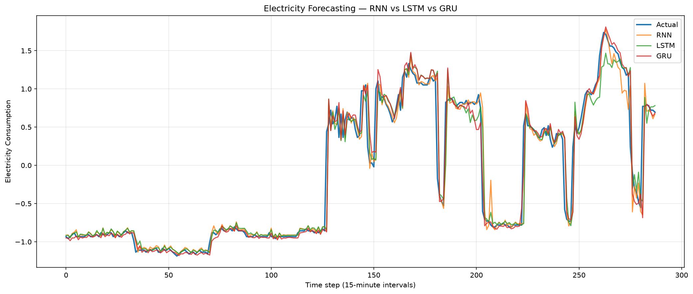

# Electricity Consumption Forecasting with PyTorch

A comparative deep learning project implementing Recurrent Neural Networks (RNNs), Long Short-Term Memory networks (LSTMs), and Gated Recurrent Units (GRUs) for short-term electricity consumption forecasting.

The project demonstrates time-series preprocessing, recurrent neural network architectures, model training, evaluation, and comparison against a simple persistence baseline.

## Project Objective

Predict electricity consumption **15 minutes ahead** using the previous **24 hours (96 observations)** of consumption data.

The project compares four forecasting approaches:

- Persistence baseline
- Vanilla RNN
- LSTM
- GRU

All three neural networks are implemented in PyTorch using a modular architecture with reusable data-processing, training, and evaluation functions.

## Dataset

**Source:** UCI Machine Learning Repository — ElectricityLoadDiagrams20112014

[Dataset reference](https://doi.org/10.24432/C58C86)

The dataset contains electricity consumption observations recorded at 15-minute intervals between January 2011 and December 2014.

For this project, the supplied training and test CSV files are combined and then split chronologically.

| Split | Period | Observations |
|---|---|---:|
| Training | 2011–2012 | 70,175 |
| Validation | 2013 | 35,040 |
| Test | 2014 | 35,040 |

Random splitting is avoided to prevent look-ahead bias.

StandardScaler is fitted exclusively on the training data and subsequently applied to the validation and test sets.

### Sequence preparation

Each model receives an input tensor with dimensions:

`(batch_size, sequence_length, input_size)`

For this project:

`(32, 96, 1)`

- Batch size: 32
- Sequence length: 96 observations (24 hours)
- Input features: 1 (electricity consumption)

Each input sequence is used to predict the next consumption value.

Historical observations from preceding periods are retained as context when creating validation and test sequences.

## Model Architectures

All neural networks share the following configuration:

| Hyperparameter | Value |
|---|---|
| Input size | 1 |
| Hidden size | 32 |
| Recurrent layers | 2 |
| Sequence length | 96 |
| Output size | 1 |
| Batch size | 32 |
| Optimiser | Adam |
| Learning rate | 0.001 |
| Loss function | Mean Squared Error |
| Maximum epochs | 20 |
| Early stopping patience | 5 |

The architectures differ in their recurrent mechanisms.

### RNN

A two-layer vanilla RNN that maintains a hidden state across time steps.

**Trainable parameters:** 3,265

### LSTM

A two-layer LSTM with input, forget and output gates, together with separate hidden and cell states.

**Trainable parameters:** 12,961

### GRU

A two-layer GRU using reset and update gates to regulate information flow through its hidden state.

**Trainable parameters:** 9,729

Each model selects the final time-step representation and passes it through a linear layer to generate one prediction.

## Training and Evaluation

Models are trained using Mean Squared Error (MSE) loss and the Adam optimiser.

The training pipeline includes:

- Mini-batch gradient descent
- Backpropagation Through Time (BPTT)
- Validation after each epoch
- Best-model checkpointing
- Early stopping

The checkpoint with the lowest validation MSE is retained for evaluation.

Final predictions are inverse-transformed using the scaler fitted on the training dataset.

Performance is measured using:

- Mean Absolute Error (MAE)
- Mean Squared Error (MSE)
- Root Mean Squared Error (RMSE)

## Experimental Results

### Validation performance

| Model | Best validation MSE | Best epoch |
|---|---:|---:|
| RNN | 0.045004 | 5 |
| LSTM | 0.041120 | 12 |
| GRU | **0.036387** | 20 |

Validation MSE is reported on standardised consumption values.

### Test performance

| Model | MAE | MSE | RMSE |
|---|---:|---:|---:|
| **Persistence** | **0.0935** | **0.0399** | **0.1998** |
| RNN | 0.1184 | 0.0455 | 0.2133 |
| LSTM | 0.1313 | 0.0505 | 0.2247 |
| GRU | 0.1928 | 0.1047 | 0.3236 |

Test metrics are calculated after inverse standardisation, in the dataset's original consumption scale.

### Forecast visualisation



The figure compares actual electricity consumption with predictions from the three neural networks over the first three days of the test period.

## Key Findings

1. **The persistence baseline achieved the lowest test error**, outperforming all three recurrent neural networks.

2. **GRU achieved the lowest validation MSE**, but its test performance was substantially worse, demonstrating that validation improvements do not guarantee better generalisation.

3. **Increased architectural complexity did not guarantee better forecasting accuracy.** The RNN achieved better test performance than both gated architectures.

4. **Short forecasting horizons favour strong simple baselines.** At a 15-minute horizon, the most recent observation is already a useful predictor of future consumption.

These findings apply to the specific dataset, model configurations and experimental runs. They do not imply that vanilla RNNs generally outperform LSTMs or GRUs.

## Project Structure

```text
Electricity-Forecasting-PyTorch/
├── data/                     # Local datasets (excluded from Git)
├── models/                   # Saved checkpoints (excluded from Git)
├── notebooks/
│   └── 01_model_experiments.ipynb
├── results/
│   ├── forecast_comparison.png
│   └── model_comparison.csv
├── src/
│   ├── __init__.py
│   ├── data_processing.py
│   ├── preprocessing.py
│   ├── data_loader.py
│   ├── training.py
│   ├── evaluation.py
│   └── models/
│       ├── __init__.py
│       ├── rnn_model.py
│       ├── lstm_model.py
│       └── gru_model.py
├── prepare_data.py
├── requirements.txt
├── .gitignore
└── README.md
```

## Installation and Usage

### 1. Clone the repository

```bash
git clone https://github.com/YOUR_USERNAME/Electricity-Forecasting-PyTorch.git
cd Electricity-Forecasting-PyTorch
```

Replace `YOUR_USERNAME` with your GitHub username.

### 2. Create a Python environment

```bash
conda create -n electricity-forecasting python=3.11 -y
conda activate electricity-forecasting
```

### 3. Install dependencies

```bash
python -m pip install -r requirements.txt
```

### 4. Prepare the dataset

Download the dataset from the source linked above and provide the two CSV files used by this project:

```text
data/raw/electricity_train.csv
data/raw/electricity_test.csv
```

The data-preparation script expects these two files with `timestamp` and `consumption` columns. The original UCI archive may require additional preprocessing to obtain this format.

Run:

```bash
python prepare_data.py
```

This reconstructs the chronological dataset, applies the predefined time-based split, scales consumption values and saves the prepared PyTorch tensors.

### 5. Explore the experiments

Open:

`notebooks/01_model_experiments.ipynb`

Select the Python environment and execute the notebook cells to train and compare the models.

## Technologies

Python, PyTorch, NumPy, pandas, scikit-learn, Matplotlib, Jupyter Notebook and VS Code.

## Conclusion

This project demonstrates a complete recurrent neural network forecasting workflow, from chronological data preparation and tensor-shape analysis to model training and comparative evaluation.

The central finding is that the simplest forecasting approach — persistence — outperformed all three neural network architectures on the held-out test dataset, reinforcing the importance of baseline comparisons and careful evaluation in applied machine learning.
